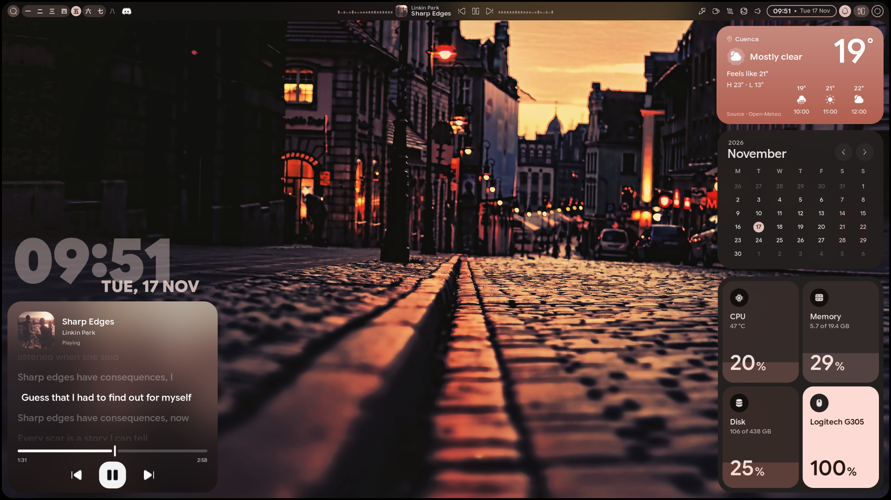

<div align="center" markdown="1">

# end4pC++

**A light, native desktop shell for Wayland, written in C++.**
Bar · launcher · notifications · control center · wallpaper · lock screen · widgets · its own Settings app.
No Qt, no QML, no GTK widgets: just `cairo` + `pango` in one small process.


[Install](#install) · [CLI reference](#command-line-reference) · [Keybinds](#keybinds) · [Configuration](#configuration) · [Languages](#languages) · [Troubleshooting](#troubleshooting)

</div>

<div align="center" markdown="1">



</div>

---

It started as a C++ port of my Quickshell config and keeps its Material 3 look.

> [!WARNING]
> **Beta.** The project changes quickly and things may break. Tested on Arch Linux with Hyprland 0.57.1 (Lua config); niri and sway (SwayFX) are supported too.
>
> **NVIDIA:** there is no support for NVIDIA graphics for the moment. The shell has only been tested on Intel and AMD.

## Contents

- [Features](#features)
- [Requirements](#requirements)
- [Install](#install)
- [Launch](#launch)
- [Command line reference](#command-line-reference)
- [Keybinds](#keybinds)
- [Configuration](#configuration)
- [Languages](#languages)
- [Troubleshooting](#troubleshooting)
- [Credits and license](#credits)

---

## Features

| | |
|---|---|
| **Bar** | Top, bottom, left or right. Styles: Panel, Float, Island, Hug, Notch, Split hug. Workspaces, media, clock (8 looks), system resources, quick actions, tray, network, volume, battery, Bluetooth, keyboard layout, updates, notifications, launcher, power, weather, removable drives, AI usage (Claude Code and Codex, read from the files they leave on your machine), dividers. Every widget has Plain, Framed and M3 looks. The Dock can live inside the bar ("Dock to panel": click to launch or cycle windows, middle click for a new window, right click to pin, drag to reorder). |
| **Panels** | Launcher (apps, files with `fd`, clipboard, emoji, calculator, QR), power menu, control center, notification popups and panel, media card with lyrics, Alt+Tab switcher with live previews. |
| **Wallpaper** | Selector with local folders, favourites, Wallhaven / Unsplash / Pexels; transitions; light/dark and generated palettes (matugen) plus ready-made themes. |
| **Capture** | Screenshot and screen recording with annotations, audio and fps options. OCR of an area (`tesseract`), Google Lens search, QR reading and QR generation. |
| **Tools** | Translator, notes, image converter, video editor, unit and currency converter (about 160 currencies), timers, stopwatch and reminders that ring with the window closed, a key bind editor. |
| **Task Manager** | Its own window (`SUPER + SHIFT + T`, `CTRL + SHIFT + Esc`, or the button in the resources popup). Processes: apps and processes with CPU, memory and disk, search, End task and Force kill with a confirmation. Performance: CPU (every core), memory, disks, network and GPU (Intel and AMD; NVIDIA is untested) with live charts. Battery and Devices tabs from `upower`. |
| **Desktop widgets** | Clock (many faces), weather, to-do, calendar, player, resources, user card, image, text, audio visualizer. |
| **Accessibility** | Screen magnifier, bigger cursor, draggable on-screen keyboard that follows the focused monitor. |
| **System** | Lock screen (`ext-session-lock` + PAM), polkit authentication agent, removable drives popup (`udisks2`), game overlay, do-not-disturb. |
| **Settings app** | Almost everything is configurable from the GUI; it saves to `~/.local/share/end4pC/config.json`. |

> [!NOTE]
> The shell is also its own command line: every panel, widget and setting can be driven from a terminal or a key bind. See the [command line reference](#command-line-reference).

---

## Requirements

### To build

On Arch (package names):

```text
meson ninja gcc pkgconf
wayland wayland-protocols wlr-protocols
cairo pango gdk-pixbuf2 librsvg
libxkbcommon pam systemd-libs
```

The build looks for the protocol XML files in `/usr/share/wayland-protocols` and `/usr/share/wlr-protocols`. It needs `wayland-protocols` 1.37 or newer: the overview and the window switcher use `ext-image-copy-capture`.

### To run

- `hyprland` **0.55 or newer** (the rules and binds in this repo are Lua), or niri, or sway/SwayFX.
- Helper tools. Most are optional: a missing one only disables the feature that uses it.

| Feature | Packages |
|---|---|
| Palette from the wallpaper | `matugen`, `python` |
| AI usage in the bar | `python` (reads `~/.claude` and `~/.codex`; nothing is sent anywhere) |
| Screenshots, recording | `grim`, `slurp`, `wf-recorder`, `wl-clipboard`, `swappy` (optional editor), `jq` |
| OCR, QR | `tesseract`, `zxing-cpp` or `zbar` (reading QR codes) |
| Audio, microphone | `wireplumber` (`wpctl`), `pipewire-pulse` (`pactl`) |
| Media player | `playerctl`, `cava` (optional visualizer) |
| Wi-Fi, Bluetooth, battery | `networkmanager`, `bluez-utils`, `upower` |
| Power profile | `power-profiles-daemon` |
| Brightness | `ddcutil` (external monitors) or `brightnessctl` |
| Online wallpaper keys | `libsecret` (`secret-tool`) and a keyring such as `gnome-keyring` |
| Clipboard history | `cliphist` |
| File choosers, thumbnails | `zenity`, `imagemagick` |
| File search | `fd` |
| Removable drives | `udisks2` |
| Weather | `curl` (Open-Meteo, no key; the city is found by your IP unless you set one) |
| Night light | `hyprsunset` or `wlsunset` |
| Updates counter | `pacman-contrib` (`checkupdates`), `paru` or `yay`, `flatpak` |

> [!IMPORTANT]
> Stop any other bar, notification daemon or wallpaper tool first (waybar, mako, swaync, swww, Quickshell...). end4pC owns the notification service, the tray and the wallpaper. Do not run another polkit agent (polkit-kde, polkit-gnome, hyprpolkitagent...) at the same time: only one can be registered per session.

---

## Install

The shell has to live in **`~/.config/end4pC`**: the Hyprland, niri and sway files of this repository point there.

### Arch Linux: the installer

```bash
git clone https://github.com/pctrade/end4pC-cpp-beta.git ~/.config/end4pC
~/.config/end4pC/installer/install.sh --dry-run    # shows what it would do, changes nothing
~/.config/end4pC/installer/install.sh              # asks before it does anything
```

It installs the packages, sets up the compositors you pick (Hyprland, niri, sway) with their configs and dotfiles, and builds the shell. A config folder you already have is moved to `~/.local/share/end4pC-installer/backup-<date>/`, never deleted. Details and options: [installer/README.md](installer/README.md).

### Any other distribution: build it yourself

```bash
git clone https://github.com/pctrade/end4pC-cpp-beta.git ~/.config/end4pC
cd ~/.config/end4pC
meson setup build
ninja -C build
```

Binaries produced in `build/`:

| Binary | What it is |
|---|---|
| `end4pC` | The shell (bar, popups, wallpaper, widgets) **and** its own command line |
| `end4pC-settings` | The Settings window |
| `end4pC-tools` | The Tools window |
| `end4pC-lock` | The lock screen |

<details>
<summary><b>Connect Hyprland</b></summary>

Add this block to your `~/.config/hypr/hyprland.lua`:

```lua
-- end4pC shell: layer rules, keybinds and autostart
do
    local ok, err = pcall(dofile, os.getenv("HOME") .. "/.config/end4pC/hyprland/end4pC.lua")
    if not ok then print("end4pC: " .. tostring(err)) end
end
```

[`hyprland/end4pC.lua`](hyprland/end4pC.lua) holds the layer rules (blur, animations), the window rule of the Settings app, loads the key binds ([`hyprland/binds.lua`](hyprland/binds.lua)) and **starts the shell with the session**. Read it before using it: some binds replace ones you may already have (`SUPER+L`, `SUPER+P`).

Machine-specific rules go in `hyprland/local.lua`: it is loaded when it exists and is not in git. Then `hyprctl reload`, or log out and in.

</details>

<details>
<summary><b>Connect niri or sway</b></summary>

See [niri/README.md](niri/README.md) and [sway/README.md](sway/README.md).

</details>

### Update

```bash
end4pC update              # shows what is new and asks before applying it
end4pC update --check      # only says whether there is something new
end4pC update -y           # applies it without asking
end4pC update --rollback   # goes back to the version that ran before the last update
end4pC --version
```

It follows the `stable` branch (`git fetch` + fast-forward, then `ninja`) and only touches the shell's own code and assets. Your settings, dotfiles and compositor configs are never changed. Shell files you edited yourself are set aside instead of overwritten. Restart the shell afterwards (`SUPER + R`).

### Lock screen

The lock screen checks your password through PAM. It uses `/etc/pam.d/end4pC-lock` if it exists, otherwise `hyprlock`, otherwise `login`, so on most systems it works without setup.

---

## Launch

Once the block above is in your Hyprland config, **the shell starts with the session**. By hand:

```bash
end4pC run                          # detached; does nothing if it is already running
~/.config/end4pC/build/end4pC       # foreground, prints its log (useful when debugging)
end4pC restart                      # or SUPER + R, works even if the shell is stuck
```

Open Settings from the bar's gear, with `SUPER + Escape`, or `end4pC settings`.

---

## Command line reference

`end4pC` with no arguments starts the shell. With arguments it **talks to the running shell** over a socket and prints the reply, so everything here works from a terminal, a key bind or a script.

> [!IMPORTANT]
> **Put the whole command in quotes** when it has more than one word: `end4pC "volume up"`, `end4pC "brightness set 70"`, `end4pC "set dock 1"`. Without the quotes only the first word reaches the shell (`end4pC volume up` is read as `end4pC volume`). Commands of one word, like `end4pC settings` or `end4pC ping`, need no quotes. Every example below with arguments is meant to be written this way.

```text
end4pC                          start the shell (foreground)
end4pC run                      start it detached (no-op if already running)
end4pC <command> [args]         send a command to the running shell
end4pC --version                installed version
end4pC help                     the built-in summary
```

### Shell and settings

| Command | Does |
|---|---|
| `ping` | Prints `pong` when the shell runs |
| `restart` / `quit` | Restart or stop the shell |
| `config` | Print the settings in use |
| `set <key> <value>` | Change any key of `config.json` and apply it live |
| `applytheme [image]` | Regenerate the palette from the wallpaper (no path: the one in use) |
| `wallpaper <image>` | Change the wallpaper |
| `collage [args]` | The wallpaper collage |
| `shapes` | List the Material 3 shapes accepted by the `*Shape` settings |
| `accentpick` | Pick an accent color from the screen |
| `update [--check\|-y\|--rollback]` | Update the shell (see [Update](#update)) |

```bash
end4pC set barPosition bottom
end4pC set barStyle notch
end4pC set selectorShape cookie9
end4pC set dock 1
```

### Panels and popups

All take `toggle` (the default), `open` or `close` unless noted.

| Command | Panel |
|---|---|
| `launcher [toggle\|open\|close\|clipboard\|emoji\|query <text>]` | Launcher; `clipboard` and `emoji` open it in that mode |
| `selector` | Wallpaper selector |
| `control [toggle\|open\|close\|wifi\|bt]` | Control center (`wifi` / `bt` jump to that page) |
| `media` | Media player card |
| `panel` | Notification panel |
| `power` | Power menu |
| `switcher [open\|next\|prev\|commit\|close]` | Alt+Tab window switcher |
| `clockpanel`, `weatherpanel`, `aipanel`, `respanel`, `batterypanel` `[toggle\|open\|close\|tab N]` | Popups of the bar's widgets |
| `audiomenu [open\|close\|tab output\|input\|apps]` | Volume popup |
| `desktopmenu [open [x y]\|close]` | The desktop's right-click menu |
| `drives` | Removable drives popup (only while a drive is plugged in) |
| `game [open\|close]` | Game overlay |
| `settings` | Settings window |
| `tools` | Tools window |
| `tasks` | Task Manager window |
| `osd volume \| osd brightness` | Show the on-screen display |

### Desktop widgets

| Command | Does |
|---|---|
| `weather\|player\|calendar\|resources\|image\|clock\|todo\|usercard\|text\|visualizer [toggle\|show\|hide]` | Show or hide one widget |
| `widget <name> on\|off [W H LEFT TOP]` | Show or hide it, with that size and position |
| `widgets lock\|unlock` | Lock or unlock the edit mode (drag and resize) |
| `usercard image [path]` | The user card's picture (no path: back to the wallpaper) |

### Bar, dock, tray and hardware

| Command | Does |
|---|---|
| `dock [on\|off\|toggle]` | The dock |
| `tray` | List the tray items |
| `tray match` | Which window each tray item maps to |
| `tray click <n>` | Click tray item `n` |
| `tray open` / `tray close` | Expand or collapse the tray |
| `brightness [get\|up\|down\|set N]` | Screen brightness |
| `volume [get\|up\|down\|set N\|mute\|unmute\|toggle]` | Volume of the default speakers (`up` and `down` use the step of the Settings; the answer is the volume it ends at) |
| `dnd [on\|off\|toggle]` | Do not disturb |
| `updates [check]` | Check pending updates now |
| `quick <n>` | Run quick action `n` of the bar |
| `identify [NAME=N ...]` | Flash a number on each screen (and assign names) |
| `lock` | Lock the screen |

### Capture, OCR and QR

| Command | Does |
|---|---|
| `screenshot [region\|screen\|window\|edit]` | Take a screenshot (default: `region`, with annotations) |
| `screenshot ocr` | Select an area and copy its text (needs `tesseract`) |
| `screenshot lens` | Select an area and search it with Google Lens |
| `screenshot qr` | Select an area and read the QR code in it |
| `qr <text>` | Show the QR code of a text or link |
| `recording` | Prints `recording` or `idle` |

### Accessibility

| Command | Does |
|---|---|
| `osk [toggle\|open\|close]` | On-screen keyboard; it opens on the focused monitor |
| `magnifier [get\|in\|out\|reset\|set N]` | Screen magnifier (Hyprland cursor zoom) |

### Timers, stopwatch, reminders

They keep running and ring with every window closed.

```bash
end4pC "timer add 25:00 pomodoro"     # 5m, 1h30m, 90 (seconds) or MM:SS
end4pC "timer pause|resume|reset|remove|clear|list"
end4pC "stopwatch start|pause|reset|lap|get"
end4pC "reminder add 08:30 weekdays stand up"   # once | daily | weekdays | YYYY-MM-DD
end4pC "reminder remove|toggle|list"
```

### Introspection (for scripts)

| Command | Prints |
|---|---|
| `workspace` | The current workspace state |
| `music` | The current media player state |
| `notifs` | The pending notifications |
| `recording` | Whether a recording is running |
| `config` | The main settings in use |

### Debug

Fake states for testing the bar; they last until the next real event.

```text
network <kind>                       force the network icon
notifications <n>                    force the notification count
periph <pct> <state> <kind> [name]   fake a peripheral battery; `periph off` clears it
```

> [!TIP]
> Quote the command when it has arguments so the shell hands it over as one string: `end4pC "launcher query firefox"`.

---

## Keybinds

| Keys | Action |
|---|---|
| `SUPER` (tap) | Launcher |
| `SUPER + W` | Wallpaper selector |
| `SUPER + P` | Power menu |
| `SUPER + L` | Lock screen |
| `SUPER + R` | Restart the shell |
| `SUPER + M` | Media player |
| `SUPER + Escape` | Settings |
| `SUPER + /` | Tools |
| `SUPER + SHIFT + S` | Screenshot (region, with annotations) |
| `SUPER + =` / `SUPER + -` | Magnifier in / out (Hyprland) |
| `ALT + Tab` / `ALT + SHIFT + Tab` | Window switcher (let go of Alt to pick) |
| Brightness keys | Brightness, with the on-screen bar |

That is only a taste: there are about a hundred binds (windows, workspaces, volume, media, apps...) and **all of them are yours to change**.

Open **Tools > Keybinds** (`SUPER + /`): search them, turn any on or off, edit or delete them, add new ones. To add one you press the shortcut itself, mouse buttons and wheel included, and pick what it does: run a command, a shell action, or a window / workspace action. Two binds on the same keys are flagged. Every change is saved and Hyprland reloads at once; delete has an undo and restore brings the originals back.

The binds are one plain table: `hyprland/binds.default.tsv` ships with the shell and your copy is `~/.config/hypr/keybinds.tsv` (created the first time you change something; delete it to go back to the originals). Binds written by hand in Lua still work: put them in `~/.config/hypr/custom/keybinds.lua`.

---

## Configuration

Your settings live in `~/.local/share/end4pC/` (or `$XDG_DATA_HOME/end4pC/`), **not** in the project folder:

| Path | Holds |
|---|---|
| `config.json` | Every setting. Without it the shell uses its defaults |
| `themes/` | Your own themes |
| `actions/` | Your own launcher actions |
| `i18n/<lang>.json` | Your own translation fixes |

The folder is created the first time the shell runs. Older versions kept it inside the project or in `~/.config/end4pC-user`: it is copied over once and nothing is deleted.

You normally change it from Settings, but `set` does the same from a terminal:

```bash
end4pC "set barPosition top"
end4pC "set barStyle split"
end4pC "set fakeRounding 1"
end4pC config
```

Wallpapers are read from `~/Pictures/Wallpapers` by default (Settings > Desktop). The Hyprland page of Settings writes to `~/.config/hypr/hyprland/shellOverrides/`, and the monitor and idle options to `~/.config/hypr/monitors.lua` and `hypridle.conf`.

---

## Languages

Settings > General > Language picks the language of the shell, the Settings window and the lock screen (default: the system language).

Texts live in `assets/i18n/<lang>.json`, one flat file per language: `"English text": "translated text"`. Every file exists as a template (a value equal to the English text means "not translated yet" and shows English). To translate, edit the value; keep the key, the spaces at the end of a text and the `·` / `•` marks. Your own fixes go in `~/.local/share/end4pC/i18n/<lang>.json` and win over the project's file.

After adding texts to the code run `python3 tools/i18n-extract.py --write`; it keeps what is already translated.

Available: `ar be ca cs de en es fr gl-ES he hu it ja ko nl nn pl pt-BR ru sv tr uk-UA vi zh-Hans zh-Hant`.

---

## Troubleshooting

| Symptom | What to check |
|---|---|
| Nothing appears | Run `~/.config/end4pC/build/end4pC` in a terminal and read the output. Make sure no other bar or notification daemon is running |
| `git clone` says the folder exists | The shell is already there: use `end4pC update`, or `rm -rf ~/.config/end4pC` first (your settings are in `~/.local/share/end4pC`, not in that folder) |
| No blur behind the bar | Check that the layer rules from `hyprland/end4pC.lua` loaded: `hyprctl layers`, then `hyprctl reload` |
| A button does nothing | The tool it calls is probably not installed (see [Requirements](#to-run)) |
| Binds do not work | Another bind may use the same keys; Hyprland runs every bind on a key. Check Tools > Keybinds |
| The commands print nothing | The shell is not running: `end4pC ping` should answer `pong` |

---

## Credits

- Inspired by [end-4's dots-hyprland](https://github.com/end-4/dots-hyprland) (illogical-impulse) and its Material look.
- Palettes from the wallpaper: [matugen](https://github.com/InioX/matugen).
- Icons: [Solar Icon Set](https://github.com/480-Design/Solar-Icon-Set) (CC BY 4.0). Glyphs: Material Symbols. Shapes: Material 3 expressive shapes.
- Dotfiles of the installer: based on end-4's dots-hyprland (GPL-3.0). More in [THIRD_PARTY.md](THIRD_PARTY.md).

## License

end4pC is free software under the [GNU General Public License v3.0](LICENSE). Copyright (C) 2026 pctrade.

The icons, fonts and configs it includes keep their own licenses: see [THIRD_PARTY.md](THIRD_PARTY.md).
